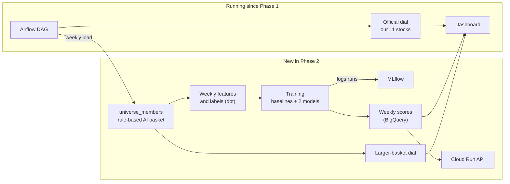

# Phase 2 Proposal: Drawdown Probability Model (MLOps)

BA882 Team 6 · Market Bubble Early Warning System · Nov 10, 2026 · Chloe (Lane 5) · Draft for team review

This replaces the Nov 8 draft (PR #67). It keeps that draft's main goal, testing whether our signal depends on the 11 stocks we picked, and changes the model so it meets the Phase 2 brief and can be trained on enough data. See [Changes from the Nov 8 draft](#changes-from-the-nov-8-draft).

## Summary

Phase 2 builds a model that answers one question for any AI-related stock:

> What is the probability that this stock falls **20% or more within the next 60 trading days**?

The model is trained on a larger, rule-based basket of AI stocks. Our 11 stocks are **left out of training** and scored as out-of-sample targets. The model is served as a **Cloud Run API**, retrained weekly through Airflow, tracked in MLflow, and monitored on real outcomes.

Alongside the model, we run the Phase 1 dial on the larger basket as a robustness check. The official roster and dial do not change.

## Questions it answers

1. **Main:** For any AI-related stock, what is the probability of a 20%+ fall within the next 60 trading days?
2. **About our picks:** Are our 11 stocks riskier than the typical AI stock?
3. **Is ML worth it:** Does the model beat simple rules?
4. **Robustness (not ML):** Does the dial on the larger basket agree with our official dial?

## Why a larger basket

- **Sample size.** 11 stocks over two years give about 5,500 daily rows, but 60-day labels overlap heavily, so there are only about 90 independent observations. That is too few to train on.
- **Selection bias.** Methodology §5 notes that the roster was chosen in Oct 2026, after most names had already broken. A model trained only on them would learn our picks, not general behavior.
- **Robustness.** If the dial on a rule-based basket agrees with ours, the Phase 1 signal does not depend on our judgment. If it disagrees, that is an important finding.

Note: a larger basket does not by itself prevent look-ahead leakage. That is handled by the time rules in [Training](#training).

## Data

| Item | Choice |
| --- | --- |
| Universe | Union of AI-themed ETF holdings: US-listed, price above $2, average daily trading above $5M, at least 60 trading days of history. About 50–150 names. The download date is logged. |
| Our 11 | Excluded from training; scored as out-of-sample targets |
| Prices | Daily adjusted close and volume, as far back as possible (at least 2020) |
| Market context | S&P 500, HYG/IEF, ARKK (already loaded in Phase 1) |
| Grain | One row per ticker per week (Friday close): fewer overlapping labels, smaller tables, matches weekly retraining |

The universe rules are written in the decision log **before** any ticker is selected. New table: `universe_members` (ticker, source, added_date, removed_date), modeled on `basket_members`. The schema contract is updated once the team agrees.

## Features

All features use only data available on date *t*.

- **Stock:** drawdown from the 252-day high; 20, 60 and 120-day returns; 60-day volatility; volume versus its 60-day average; beta to the S&P 500 and to ARKK; days since listing
- **Market:** S&P distance from its high; official dial level; credit ratio distance from its high; breadth of the larger basket

## Label

`1` if the lowest close in the next 60 trading days is at least 20% below the close on date *t*, otherwise `0`.

The most recent 60 trading days have no label yet, so they are used only for scoring.

## Training

- **Time split, never random.** Train on older data, validate on the next period, test on the most recent labeled period. Leave a 60-trading-day gap between the sets so labels do not overlap.
- **Models, in order:**
  1. Baseline A: current drawdown only
  2. Baseline B: 60-day volatility only
  3. Logistic regression
  4. Boosted trees
- **Metrics:** AUC, precision of the top 10% of scores, and calibration (predictions of 30% should come true about 30% of the time). Each is compared with the base rate and both baselines.
- **Tracking:** MLflow logs parameters, metrics, the universe snapshot date and the model version for every run.
- **Retraining:** weekly through Airflow.

If no model beats the baselines on the test period, we say so and serve the best baseline. That is still a valid result.

## Serving

A Cloud Run API reads the latest weekly scores from BigQuery:

```
GET /risk?ticker=NVDA
-> { ticker, as_of, prob_drop_20pct_60d, rank_in_universe, dial_level, model_version }

GET /basket
-> the same fields for our 11 stocks
```

Reading a pre-scored table keeps the API fast and cheap. The dashboard shows the scores for our 11 next to the larger basket, and the larger-basket dial next to the official dial.

## Monitoring

- **Accuracy over time:** predictions made 60 trading days ago now have outcomes, so we track rolling AUC and calibration
- **Feature drift:** weekly changes in feature distributions
- **Pipeline health:** data freshness, API errors and latency

## Architecture



## Lanes (proposed)

| Lane | Owner | Phase 2 work |
| --- | --- | --- |
| 1 Ingestion & orchestration | Kean | Load prices for `universe_members` with backfill; weekly Airflow tasks for features, retraining and scoring |
| 2 Warehouse & dbt | Ahrar | `universe_members` seed and tests; weekly feature and label tables; training and scoring models |
| 3 Signal logic | Javier | Universe rules in the decision log; label and time-split rules; evaluation against baselines; larger-basket dial reusing Phase 1 logic |
| 4 Dashboard | Myhill | Scores for our 11 versus the larger basket; larger-basket dial next to the official dial; model version and last-trained date |
| 5 Platform & PM | Chloe | MLflow server and Cloud Run API infrastructure (Terraform where practical); IAM and cost check; Phase 2 milestone and issues; AI log |

Lane assignments follow the Nov 8 draft and are open for discussion.

## Timeline (proposed)

| Dates | Work |
| --- | --- |
| Nov 10–12 | Agree on this proposal; universe rules, label and time-split rules written down |
| Nov 12–16 | Universe loaded; feature and label tables; MLflow server and API skeleton |
| Nov 17–20 | Baselines and models trained and tested; API serving real scores |
| Nov 20–22 | Dashboard panels; monitoring; larger-basket dial comparison |
| Nov 23 | Phase 2 freeze |

The Phase 2 due date is still to be confirmed with the professor.

## Known limits

- **Survivorship:** delisted stocks are missing from today's ETF holdings, which makes past sell-offs look milder.
- **Hindsight universe:** today's holdings, not the holdings at each past date.
- **Few market regimes:** results may be dominated by the 2022 sell-off.

We state these next to every result.

## Changes from the Nov 8 draft

| Nov 8 draft | This proposal | Why |
| --- | --- | --- |
| Weekly batch scores, no API | Cloud Run API | The Phase 2 brief requires a deployed, callable model |
| Labels from 5–6 S&P sell-off windows | Label per stock per week (20%+ fall within 60 days) | Many more independent examples; clear timing with no look-ahead |
| "Sold first" label with beta and volatility as features | Forward drawdown label, with drawdown and volatility as explicit baselines | The old label is close to beta itself, so the model would mostly relearn its own features |
| About 2,000 stocks back to 2018 | 50–150 rule-based AI stocks | Fits a two-week phase and Lane 1's load |
| Monitoring on turnover and drift | Also accuracy on real outcomes | Labels arrive after 60 trading days, so we can measure accuracy |

Kept from the Nov 8 draft: our 11 stocks are never used for training, the official roster and dial do not change, rules are written before training, and baselines are reported honestly.

## Open questions

- [ ] Phase 2 due date and presentation format
- [ ] Which AI-themed ETFs define the universe
- [ ] BigQuery ML or Python (scikit-learn) for training
- [ ] MLflow hosting that fits the course credits
- [ ] Label thresholds (20% and 60 days) to be confirmed by Lane 3
