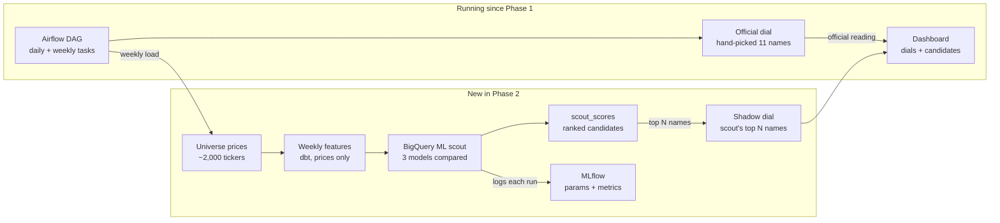
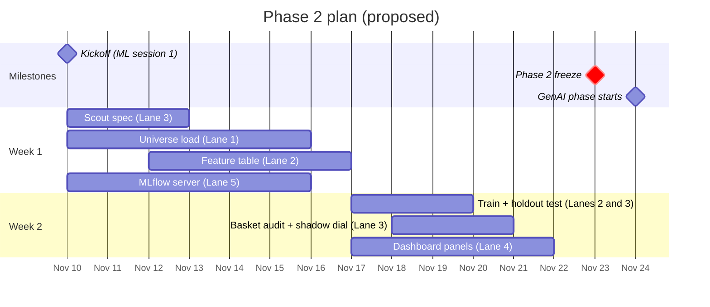

# Phase 2 Proposal: AI Basket Scout (MLOps)

BA882 Team 6 · Market Bubble Early Warning System · Nov 8, 2026 · Javier (Lane 3) · Draft for the Nov 10 kickoff

## Summary

Phase 2 builds a **basket scout**: a model that learns, from how about 2,000 US stocks behaved around past market sell-offs, which stocks professionals sell first, and ranks today's candidates every week. Its labels come from the market through a written rule. Our 11 hand-picked names are never used for training.

That lets Phase 2 **audit** Phase 1. The scout scores our basket like any other stock: our names that score low may have been picked on narrative, and high scorers we left out may have been missed. A **shadow dial**, computed on the scout's top names, sits next to the official reading as an independent check. The official roster and dial do not change.

In Phase 3, an LLM reads the candidates' SEC filings to judge whether each one is priced on an AI story. Together the two phases automate both of our roster admission tests.

**Decision asked at the Nov 10 kickoff:** agree on this direction, the stock universe, and the lane assignments.

## Why this project

Our basket is the most subjective part of Phase 1. Methodology §5 says it plainly: the roster was chosen in Oct 2026, after most names had already broken, so the backfilled history is informed by hindsight. The scout tests that weakness with labels the market sets, so it can confirm or contradict our picks.

Our roster rules have two admission tests. Each one maps to the phase whose tools can measure it:

| Admission test | What can measure it | Phase |
| --- | --- | --- |
| Professionals sell it first | Price behavior: falls earlier and harder than the market in sell-offs, high sensitivity to ARKK, large volatility and volume swings | **Phase 2:** ML on prices |
| Priced on story, not cash flow | Text: AI narrative in filings and earnings calls, revenue versus promises, data centers funded with debt | **Phase 3:** LLM on SEC filings |

The three phases become one product: a warning system (Phase 1) that finds its own canaries (Phase 2) and checks their story (Phase 3). The brief grades novelty and relevance first; a model that strengthens our own signal answers both.

## How the scout works

**Universe.** Every US common stock on Nasdaq and NYSE that clears a liquidity floor, roughly 2,000 names, with prices back to 2018 so the history holds several sell-offs. Ticker lists come from the free Nasdaq Trader symbol files; the floor (for example price above $2 and average daily trading above $5M) is computed from prices alone. Fallback if ingestion strains: S&P 500 plus holdings of tech and thematic ETFs plus IPOs since 2020, a few hundred names.

**Labels, set by the market.** A written rule, fixed in the spec before any training:

1. A **sell-off window** is any period when the S&P 500 falls at least 5% from its record high. The 2018 to 2026 history should hold several (late 2018, 2020, 2022, mid-2024, early 2025); the rule decides, not us.
2. In each window, a stock is labeled **sold first** if it peaked before the S&P did and fell much harder than the S&P (thresholds in the spec).
3. Every stock in every window gets a label: thousands of examples, none chosen by the team.

**Features** (measured before each window opens, prices only):

- Volatility and maximum drawdown over the prior year
- Sensitivity (beta) to the S&P 500 and to ARKK
- Distance from 52-week high, volume spikes, listing age
- How it behaved in the previous sell-off window, when there was one

No feature refers to our basket, so the model cannot learn our picks.

**Models, in order:**

1. Baseline, no training: rank by beta to the S&P alone.
2. BigQuery ML logistic regression.
3. BigQuery ML boosted trees.

Training uses earlier windows and testing uses the latest ones, never a random split. Every week, the chosen model scores today's universe.

## How we know it works

Our 11 names are the thing being tested, never the answer key. Lane 3 writes these tests down before any training run, as with the Phase 1 thresholds.

1. **Holdout sell-offs.** Train on the earlier windows, predict the latest ones. Report precision and recall of the "sold first" label against the no-training baseline. This is the model's own report card.
2. **Basket audit.** Score our 11 names like any other stock and report where each one ranks. Low scorers may have been picked on story rather than behavior; high scorers we left out may have been missed. Either result is a finding about Phase 1.
3. **Shadow basket.** Run the existing dial logic on the scout's top N names, next to our hand-picked 11. Because the scout never saw our picks, agreement is real evidence that the Phase 1 signal does not hinge on our judgment, and disagreement is the most important result to present.

**Guardrails:**

- The scout proposes; it never edits the official roster. Roster changes still follow the logged rules.
- No feature may use a price after the window it predicts.
- The labeling rule is itself a choice (window definition, thresholds). It is written and logged before training, and never tuned to make our basket look good.
- If the model cannot beat the baseline on test 1, we say so and ship the baseline. That is still a valid result.

## Architecture

The scout runs on the stack we already have; the only new service is the MLflow server. Training and scoring are SQL inside BigQuery, driven by dbt and the Airflow DAG.

The shadow dial reuses the Phase 1 dial logic unchanged, only on a different basket. **Monitoring** (the Nov 17 topic) tracks week-over-week turnover in the top candidates and drift in the feature distributions.

## Lanes

Everyone keeps their Phase 1 lane. Lane 1 carries the largest new load (the universe), so Lane 5 backs it up if needed.

| Lane | Owner | Phase 2 work |
| --- | --- | --- |
| 1 Ingestion & orchestration | Kean | Universe ticker list and liquidity floor; weekly universe price load with backfill to 2018; Airflow tasks for weekly feature build, retrain and scoring |
| 2 Warehouse & dbt | Ahrar | Weekly feature table in dbt; training set with labels; BigQuery ML `CREATE MODEL` and `ML.PREDICT` as dbt models; `scout_scores` and shadow-basket marts with tests |
| 3 Signal logic | Javier | Scout spec (sell-off window rule, labeling thresholds, features) before training; the three evaluation tests, including the basket audit; shadow-dial logic reusing Phase 1 rules; Methodology and decision log |
| 4 Dashboard | Myhill | "Scout candidates" panel; shadow dial next to the official dial; model version and last-trained date |
| 5 Platform & PM | Chloe | MLflow tracking server (Cloud Run + GCS, via Terraform); IAM for BigQuery ML; cost check on the larger universe; Phase 2 issues and milestone; AI log |

## Timeline

Two working weeks, matched to the two ML sessions (Nov 10 and Nov 17). The spec comes first so no model is trained before the tests are fixed; the universe load starts the same day because everything else waits on it.

Dates are a proposal for the kickoff; the Phase 2 due date is still to be confirmed.

## Phase 3 preview

Phase 2 finds stocks that *behave* like canaries; Phase 3 checks whether they are *priced on an AI story*, our second admission test.

- **Source:** SEC filings (10-K, 10-Q, 8-K) for the scout's top candidates, through the free EDGAR feeds the course lists.
- **LLM step:** extract a few structured fields per company, such as share of the business described as AI, revenue versus forward promises, and new debt raised for data centers.
- **Output:** a story score that joins the scout score in the warehouse, so the candidate list shows both tests side by side.

This matches the Phase 3 brief (GenAI pipelines that augment the warehouse) and the Nov 24 to Dec 1 sessions on AI data pipelines and RAG. We only need to agree on it now so Phase 2 tables leave room for it.

## Open questions and risks

- [ ] **Phase 2 due date and presentation:** not in the brief we have. Ask the professor on Nov 10.
- [ ] **Universe:** full listed universe with a liquidity floor (about 2,000 names) or the narrower fallback? Decide at kickoff with Lane 1.
- [ ] **Backfill depth:** 2018 gives several sell-off windows; confirm the price load and storage cost for about 2,000 tickers over eight years.
- [ ] **MLflow hosting:** Cloud Run + GCS is the default plan; confirm after the Nov 10 class whether the professor recommends a setup that fits the course credits.
- [ ] **Ingestion limits:** confirm yfinance handles the load; Tiingo is the existing fallback.

**Risks:**

- *Few sell-off windows.* Even back to 2018 there may be only five or six. Each window labels thousands of stocks, but the test set is the latest one or two windows, so results carry wide uncertainty and we say so.
- *Survivorship.* Stocks that delisted are missing from today's ticker lists, which makes past sell-offs look milder. We state it next to every result.
- *Load on Lane 1.* The universe and the deeper backfill are the biggest new pieces; the fallback universe and Lane 5 backup cap the risk.
- *Phase 3 overlap from Nov 24.* Anything not done by then is cut, not carried.
